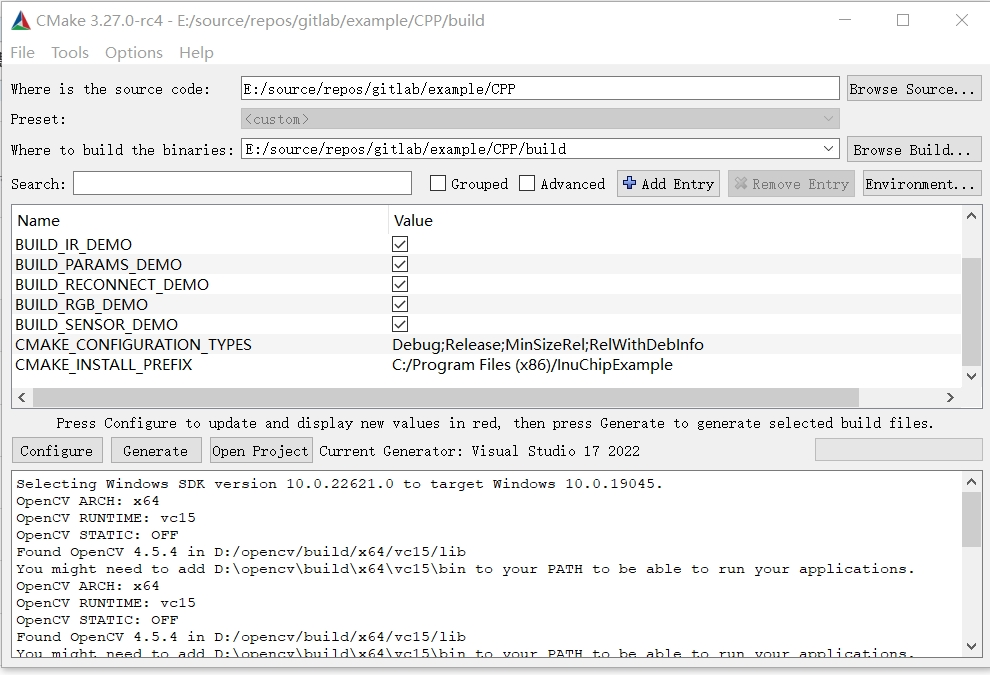

# 中文版 (English Vestion at below)

此处是说明如何编译示例的 example 程序，在此之前，应该正确的安装SDK，如没有，请参考SDK安装手册。

# 说明

此example示例提供了基本的调用方法，仅供用来参考。 客户需要根据自己的实现情况对代码进行修改，使之符合真实的使用场景。

# 目录结构说明
3drparty ------------- 示例代码中用到第三方库开源库，可以依据自己的需要进行删减 
--- spdlog ----------- 日志库
--- yaml ------------- 读取参数参数配置库
CMake ----------------  cmake 的配置选项
app ------------------ 模组各个功能模块的示例代码
--- cfg -------------- 模组运行时的配置参数
--- demoXXX ---------- 模块示例代码
component -------- 模组模块
include ---------- 头文件
# Windows 编译

## 新建一个build 目录
修改 CMake 目录下的 Build.cmake 文件

add_definitions(-D_BIG424_) --------------- 如果SDK版本高于 4.24，那么要打开此配置
SET(OpenCV_DIR "D:/opencv/build") ---- 指明 opencv 安装路径
SET(PCL_DIR "D:/PCL 1.12.1") ------------- 指明PCL 安装路径
## 使用CMAKE GUI

1. 修改 CMake/Build.cmake 
   修改OpenCV 目录，例如示例安装的位置： D:/opencv/build 到安装目录
2. 用 CMake GUI 打开 

3. 按照 Configure,Generate,Open Project ,这时就可以在 VC 中进行编译调试了。

如果看到 'it set OpencCV_FOUND to FALSE .....'
一个可能的原始是VC版本太高，opencv 没有认出，可以在 CMakeLists.txt 里打开pen OpenCV_RUNTIME 设置!"

# Linux 编译

确保安装cmake 版本高于 15

修改 CMake 目录下的 Build.cmake 文件

add_definitions(-D_BIG424_) --------------- 如果SDK版本高于 4.24，那么要打开此配置
1. mkdir build
2. cmake ..
3. make

在 build/app/demoxxx  下即可看到编译好的可执行程序。

# English Version:
